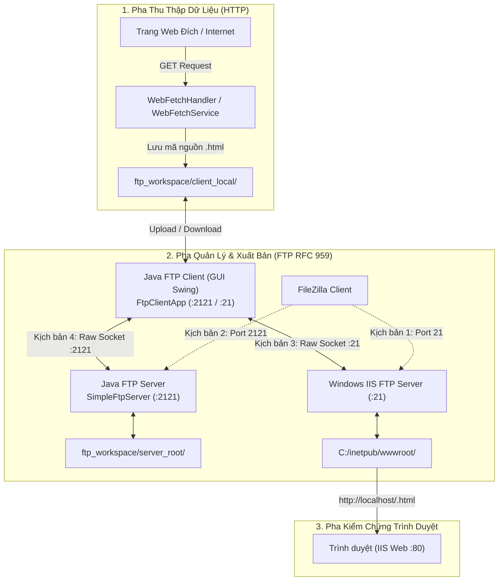

# Kế Hoạch Triển Khai: Java FTP Server & Java FTP Client (RFC 959)

> **Mục tiêu:** Xây dựng trọn bộ **Java FTP Server** (lắng nghe cổng `:2121`) và **Java FTP Client** (Giao diện Swing & CLI kiểm thử) bằng **100% Java thuần (JDK 24 - Raw TCP Socket)**, không phụ thuộc bất kỳ thư viện bên ngoài nào. Hệ thống tuân thủ nghiêm ngặt chuẩn **RFC 959**, tích hợp liền mạch với **HTTP Web Client** sẵn có, và vượt qua ma trận kiểm thử kết nối chéo với **Windows IIS FTP Server (Port 21)** và **FileZilla Client**.

---

## 1. Tổng Quan Kiến Trúc & Bối Cảnh

Hệ thống được thiết kế theo mô hình Client-Server phân tầng, phối hợp giữa HTTP và FTP:

---

## 2. Các Quyết Định Thiết Kế Quan Trọng

> [!IMPORTANT]
> **1. 100% Java thuần (JDK 24 - Raw TCP Sockets):**
> - Sử dụng `java.net.ServerSocket` và `java.net.Socket`.
> - Không sử dụng Apache Commons Net hay Apache MINA FtpServer để đảm bảo tính hàn lâm, đạt điểm tối đa môn Lập trình mạng và giữ nguyên lệnh `compile.bat` siêu tốc.
> 
> **2. Tách bạch Kênh điều khiển (Control Channel) & Kênh dữ liệu (Data Channel):**
> - **Control Channel:** Kết nối TCP liên tục trên cổng 2121 (hoặc 21), truyền nhận các dòng text kết thúc bằng `\r\n`.
> - **Data Channel:** Mở động theo từng lệnh (`LIST`, `RETR`, `STOR`), hỗ trợ cả **Passive Mode (`PASV`, `EPSV`)** và **Active Mode (`PORT`)**.
> 
> **3. Cơ chế Sandbox (Chroot Directory) an toàn:**
> - Server tự động giới hạn mọi thao tác trong `ftp_workspace/server_root/`, triệt tiêu hoàn toàn nguy cơ tấn công Path Traversal (`../`).
> 
> **4. Tính năng Chuyển Server-to-Server (Sync Bridge):**
> - Cho phép chọn 1 file từ Java FTP Server, tải tạm về máy client và tự động đổi kết nối để upload thẳng lên IIS FTP Server (`C:\inetpub\wwwroot`), sau đó mở trình duyệt kiểm tra tại `http://localhost/<file>.html`.

---

## 3. Danh Sách Các Tập Tin Cần Tạo & Sửa Đổi

### A. Gói Máy Chủ FTP (`src/server/ftp/`)
1. **`SimpleFtpServer.java`** `[MỚI]`:
   - Lớp khởi chạy chính (Entry Point), mở `ServerSocket` lắng nghe tại cổng `2121`.
   - Sử dụng **Virtual Threads** (`Executors.newVirtualThreadPerTaskExecutor()`) để mỗi phiên FTP Client kết nối vào sẽ chạy trên một Virtual Thread độc lập.
2. **`FtpSessionHandler.java`** `[MỚI]`:
   - Bộ máy xử lý giao thức (State Machine) trên Control Channel.
   - Phân tích và phản hồi các lệnh RFC 959: `USER`, `PASS`, `SYST`, `FEAT`, `PWD`, `TYPE`, `PASV`, `EPSV`, `PORT`, `LIST`, `RETR`, `STOR`, `DELE`, `CWD`, `CDUP`, `MKD`, `RMD`, `NOOP`, `QUIT`.
3. **`FtpDataChannel.java`** `[MỚI]`:
   - Quản lý kênh dữ liệu: Mở `ServerSocket` cổng ngẫu nhiên cho `PASV`/`EPSV` và kết nối ngược cho `PORT`.
   - Thực hiện truyền dữ liệu dạng nhị phân (Binary stream) cho `RETR`, `STOR` và danh sách dạng text cho `LIST`.
4. **`FtpUserAuth.java`** `[MỚI]`:
   - Xác thực người dùng: Hỗ trợ `anonymous` (mật khẩu tùy ý) và tài khoản quản trị `admin` / `admin123`.

### B. Gói Máy Khách FTP (`src/client/ftp/`)
1. **`FtpFileItem.java`** `[MỚI]`:
   - Đối tượng lưu thông tin file/thư mục: `name`, `size`, `isDirectory`, `lastModified`.
2. **`SimpleFtpClient.java`** `[MỚI]`:
   - Engine FTP Client bằng socket thuần. Cung cấp API lập trình: `connect()`, `login()`, `enterPassiveMode()`, `listFiles()`, `uploadFile()`, `downloadFile()`, `deleteFile()`, `disconnect()`.
   - Có callback listener `FtpLogListener` để bắn log thời gian thực ra giao diện.
3. **`FtpClientApp.java`** `[MỚI]`:
   - Giao diện đồ họa Swing (Dual-Pane Explorer):
     - **Thanh điều khiển nhanh:** Nút chọn `[Java Server :2121]` và `[IIS Server :21]`, nút `Connect / Disconnect`.
     - **Cột trái:** File cục bộ (`ftp_workspace/client_local`).
     - **Cột giữa:** Nút `Upload >>`, `<< Download`, `Đồng bộ Server-to-Server`.
     - **Cột phải:** File trên FTP Server (tự động load từ `LIST`).
     - **Khung Console dưới:** Hiển thị trực tiếp log giao tiếp RFC 959 (xanh lá cây cho 2xx, đỏ cho lỗi 4xx/5xx).
4. **`CrossTestFtpClient.java`** `[MỚI]`:
   - Kịch bản kiểm thử tự động dòng lệnh (CLI): Tự động test login, PASV, upload file mẫu, list file, download và so sánh mã hash SHA-256 xác thực toàn vẹn dữ liệu.

### C. Tích Hợp Hệ Thống & Scripts Chạy Nhanh
1. **`src/client/WebClientApp.java`** `[SỬA ĐỔI]`:
   - Bổ sung nút **"Mở FTP Client..."** trên thanh công cụ để người dùng sau khi Fetch HTML có thể mở ngay trình quản lý FTP để đồng bộ file.
2. **`compile.bat`** `[SỬA ĐỔI]`:
   - Thêm `src\server\ftp\*.java` và `src\client\ftp\*.java` vào danh sách biên dịch của `javac`.
3. **`run_ftp_server.bat`** `[MỚI]`:
   - Script 1-click khởi động Java FTP Server trên cổng `2121`.
4. **`run_ftp_client.bat`** `[MỚI]`:
   - Script 1-click mở giao diện đồ họa `FtpClientApp`.
5. **`run_cross_test_ftp.bat`** `[MỚI]`:
   - Script chạy kiểm thử ma trận chéo tự động.

---

## 4. Kế Hoạch Triển Khai Chi Tiết Từng Bước (Tasks)

- [ ] **Bước 1: Chuẩn bị thư mục & Cập nhật `compile.bat`**
  - Tạo cấu trúc thư mục `ftp_workspace/client_local` và `ftp_workspace/server_root`.
  - Cập nhật [`compile.bat`](file:///e:/luyentaphe/LapTrinhMang/Http%20server/compile.bat) để sẵn sàng biên dịch các file trong `src/server/ftp` và `src/client/ftp`.

- [ ] **Bước 2: Triển khai Lõi Java FTP Server (`src/server/ftp/`)**
  - Tạo `FtpUserAuth.java` kiểm tra thông tin đăng nhập và ánh xạ thư mục gốc sandbox.
  - Tạo `FtpDataChannel.java` quản lý mở socket dữ liệu cho `PASV` (cổng ngẫu nhiên 50000–51000) và `PORT`.
  - Tạo `FtpSessionHandler.java` xử lý vòng đời lệnh Control Channel theo chuẩn RFC 959.
  - Tạo `SimpleFtpServer.java` lắng nghe kết nối tại cổng `2121` với Virtual Threads.

- [ ] **Bước 3: Triển khai Lõi Java FTP Client (`src/client/ftp/`)**
  - Tạo `FtpFileItem.java` lưu trữ thuộc tính tập tin.
  - Tạo `SimpleFtpClient.java` hiện thực hóa giao thức truyền nhận FTP Client qua raw TCP Socket.
  - Bổ sung `FtpLogListener` để thu thập log thoại mạng `> COMMAND` và `< RESPONSE`.

- [ ] **Bước 4: Triển khai Giao Diện Swing & Tích Hợp (`FtpClientApp.java`)**
  - Tạo giao diện `FtpClientApp.java` với 2 bảng duyệt file (Local / Remote), danh sách nút chức năng và Console Log trực tiếp.
  - Cài đặt tính năng chuyển file chéo giữa 2 Server (Server-to-Server qua Client trung gian).
  - Thêm nút liên kết trong [`WebClientApp.java`](file:///e:/luyentaphe/LapTrinhMang/Http%20server/src/client/WebClientApp.java) để chuyển tiếp thuận tiện từ khâu cào web sang khâu upload FTP.

- [ ] **Bước 5: Xây dựng Bộ Kiểm Thử Tự Động & Scripts (.bat)**
  - Tạo `CrossTestFtpClient.java` kiểm tra tự động các ca test cơ bản và so khớp nội dung byte.
  - Tạo [`run_ftp_server.bat`](file:///e:/luyentaphe/LapTrinhMang/Http%20server/run_ftp_server.bat), [`run_ftp_client.bat`](file:///e:/luyentaphe/LapTrinhMang/Http%20server/run_ftp_client.bat), [`run_cross_test_ftp.bat`](file:///e:/luyentaphe/LapTrinhMang/Http%20server/run_cross_test_ftp.bat).
  - Cập nhật tài liệu [`README.md`](file:///e:/luyentaphe/LapTrinhMang/Http%20server/README.md) hướng dẫn toàn bộ quy trình.

---

## 5. Kế Hoạch Kiểm Thử & Nghiệm Thu (Verification Plan)

### A. Kiểm thử tự động (Automated Verification)
1. **Biên dịch:** Chạy `compile.bat`, kỳ vọng kết quả `COMPILED OK - javac 24`.
2. **Kiểm thử CLI (`run_cross_test_ftp.bat`):**
   - Tự động kết nối tới Java FTP Server (`:2121`) bằng tài khoản `anonymous`.
   - Chuyển chế độ Passive Mode (`PASV`).
   - Tải lên một file kiểm thử `test_crawl.html`.
   - Lấy danh sách `LIST` kiểm tra file có xuất hiện trên server không.
   - Tải về (`RETR`) thành `test_downloaded.html` và so khớp mã băm SHA-256 để đảm bảo truyền nhị phân không mất mát dữ liệu.
   - Kết nối tới IIS FTP Server (`:21`) nếu dịch vụ đang bật để upload `test_iis.html` vào `C:\inetpub\wwwroot`, sau đó dùng `HttpClient` gọi `http://localhost/test_iis.html` trên IIS Web (:80) để xác nhận hiển thị thành công.

### B. Kiểm thử thủ công với Giao diện (Manual GUI Verification)
1. Mở `run_ftp_server.bat` $\rightarrow$ Server sẵn sàng tại `:2121`.
2. Mở `run_ftp_client.bat`:
   - Nhấn nút nhanh `[Java FTP Server :2121]` $\rightarrow$ Bấm `Connect` $\rightarrow$ Đăng nhập thành công, log hiện `230`.
   - Chọn file từ bảng Local $\rightarrow$ Bấm `Upload >>` $\rightarrow$ File xuất hiện ngay bên bảng Remote.
   - Nhấn nút nhanh `[IIS Windows :21]` $\rightarrow$ Bấm `Connect` $\rightarrow$ Bấm `Đồng bộ sang IIS` $\rightarrow$ File được chuyển vào `C:\inetpub\wwwroot`.
   - Mở trình duyệt Chrome/Firefox vào `http://localhost/<file>.html` $\rightarrow$ Trang web hiển thị hoàn hảo.
3. Khi bạn cài đặt FileZilla: Nhập `Host: localhost`, `Port: 2121`, `User: anonymous` $\rightarrow$ Kết nối, xem file và kéo thả mượt mà.
